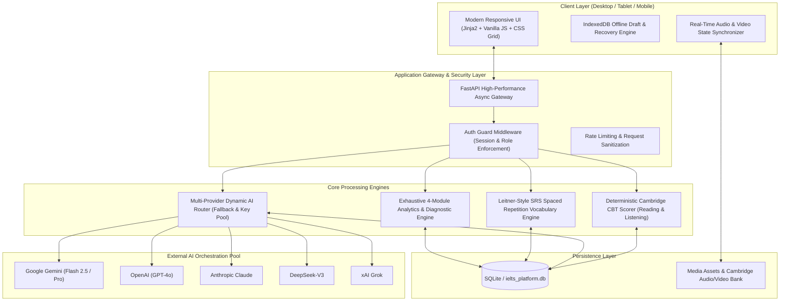

# 🎓 AI IELTS — Cambridge 9-Band Learning & CBT Practice Ecosystem

<div align="center">


<p align="center">
  <strong>An enterprise-grade, full-stack AI platform built to deliver authentic Cambridge Computer-Based Testing (CBT), subjective multi-provider AI evaluation, and a real-time responsive 1-on-1 AI IELTS Teacher — purpose-engineered for Bengali native speakers to crack Band 7.5 – 9.0.</strong>
</p>

</div>

---

> [!CAUTION]
> ### 🔒 Intellectual Property & Commercial License Notice
> This repository is published **strictly as a technical portfolio showcase** to demonstrate full-stack software engineering, distributed AI orchestration, and system architecture capabilities.
>
> **Commercial use, hosting as a public/paid Software-as-a-Service (SaaS), white-labeling, or unauthorized redistribution is strictly prohibited** under the **[PolyForm Noncommercial License 1.0.0](LICENSE)**. 
> 
> *For commercial licensing inquiries, enterprise partnerships, or investment discussions, please contact the repository author.*

> [!TIP]
> ### 🇧🇩 Engineered for Bengali Native Speakers (মাতৃভাষা বাংলাভাষীদের জন্য বিশেষায়িত)
> This platform is specially designed for learners whose **mother tongue is Bengali (বাংলা)** to help them overcome native-language challenges and crack **IELTS Band 7.5 – 9.0**. While preserving 100% authentic British Council & Cambridge English standards, the engine introduces **bilingual pedagogical scaffolding, on-demand Bengali translations ("বাংলায় অর্থ"), and L1-interference grammar/pronunciation corrections**.

---

## 🏛️ High-Level System Architecture



---

## 🌟 4-Module Examination & Practice Matrix

| Module | Core Architecture & Engine | Assessment Method | Key Features |
| :--- | :--- | :--- | :--- |
| **📖 Reading** | Split-Screen CBT Layout with Paragraph Sync | 100% Deterministic Cambridge Rubric | True/False/Not Given, Matching Headings, timer, auto-flagging |
| **🎧 Listening** | Web Audio API + Audio-Seek Synchronizer | 100% Deterministic Cambridge Rubric | 4 Sections, authentic audio streams, spelling tolerance algorithms |
| **✍️ Writing** | Asynchronous Rubric LLM Evaluator | Subjective 4-Criterion Band Rubric | Task 1 & 2 word count validator, line-by-line feedback, rewrite suggestions |
| **🗣️ Speaking** | Speech-to-Text Stream + AI Examiner | Subjective 4-Criterion Band Rubric | 3-Part authentic interview, fluency analysis, phonetic feedback |
| **👩‍🏫 AI Teacher** | Dual-State Video Synchronizer (Photo/MP4) | Real-time Adaptive Pedagogical Scaffolding | 77 Question Types master syllabus, Banglish/Bilingual scaffolded teaching |

---

## 🇧🇩 Purpose-Built for Bengali Native Speakers (মাতৃভাষা বাংলাভাষীদের জন্য বিশেষায়িত ফিচারস)

Bengali learners face distinct linguistic and cognitive hurdles when preparing for Cambridge IELTS — ranging from mother-tongue syntactic interference to unfamiliar Western cultural contexts. This platform solves them directly in the architecture:

1. **🌐 One-Click Bengali Translation ("বাংলায় অর্থ")**:
   - Every complex examiner speaking prompt (Dr. Sarah Jenkins), reading comprehension sentence, and grammar rule includes an on-demand toggle for clear Bengali translation and contextual breakdown.
2. **🎯 Bengali L1 Interference Error Diagnostic**:
   - The Automated Mistake Notebook and AI Writing Evaluator specifically target high-frequency grammatical blindspots common among Bengali speakers (e.g. article confusion `a/an/the`, preposition miscollocations like *"discuss about"*, and complex compound clause construction).
3. **🗣️ Phonetic & Accent Neutralization Guidance**:
   - Audio and speaking modules incorporate pronunciation analysis addressing Bengali phonetic traits (distinguishing `/v/` vs `/b/`, `/f/` vs `/p/`, aspiration, and English sentence rhythm/stress patterns).
4. **💡 Bilingual Adaptive Scaffolding with AI Teacher ARIA**:
   - ARIA dynamically detects candidate struggle levels. For difficult Band 8.5+ abstract topics, she provides bilingual explanations (*Bangla + English conceptual bridge*) before guiding candidates to express the idea in authentic, idiomatic British English.
5. **🧠 Contextual Analogy Bridging**:
   - Bridges unfamiliar European/Western concepts (e.g., historical architecture, environmental zoning, social housing) into relatable Bengali analogies, allowing candidates to build substantive arguments in Writing Task 2 and Speaking Part 3 without memorization anxiety.

---

## 🚀 Key Engineering & Architectural Innovations

### 1. 🔄 Multi-Provider Resilient AI Routing & Key Pool Engine
- **Dynamic Failover Protocol**: Automatically rotates across **5 premier AI providers** (Google Gemini, OpenAI GPT, Anthropic Claude, DeepSeek, and xAI Grok).
- **Automated Rate-Limit & Health Recovery**: Features active key pooling, latency metrics recording, and automatic backoff on HTTP `429 Too Many Requests` or `503 Service Unavailable`.
- **Configurable Routing Strategies**: Runtime toggling between `balanced`, `quality-first`, `latency-optimized`, and `cost-conscious` routing via the administrative controller.

### 2. 🎯 Deterministic Cambridge Objective Scoring Engine
- **Exact Cambridge Rubric Alignment**: 100% deterministic matching for Reading (40 questions) and Listening (40 questions).
- **Variant Matching Logic**: Handles complex Cambridge acceptable answer formats (British vs. American spelling, optional parenthetical words, slash variants, hyphenated terms, and case insensitivity).
- **Automated Diagnostic Logging**: Automatically flags errors, calculates exact Cambridge Band Scores (0.0 – 9.0), and populates the student's **Automated Mistake Notebook** with precise passage evidence.

### 3. 👩‍🏫 Real-Time Multimedia Synchronization (AI Teacher "Aria")
- **Audio-Visual State Synchronization**: Dual-state media rendering that transitions between a standby photo model (`ayra_idle.jpg`) and a speaking digital avatar (`ayra_teacher.mp4`), strictly synchronized with text-to-speech audio streams.
- **Multilingual Pedagogical Scaffolding**: 5-level adaptive scaffolding supporting *English Only*, *Mother Language (Bangla)*, and *Bilingual (Banglish)* explanations for complex grammar and band-boosting collocations.

### 4. 🧠 Adaptive Spaced Repetition System (SRS)
- **Leitner-Style Memory Decay Algorithm**: Tracks individual word and grammar topic mastery across 5 stages: `Unseen` ➔ `Seen` ➔ `Recognized` ➔ `Understood` ➔ `Mastered`.
- **Active vs. Passive Recall Tracking**: Separates passive recognition during CBT reading from active production in writing/speaking evaluations.

### 5. 🛡️ Industrial Security & Session Protection
- **HttpOnly Cookie & Session Guard**: Enforces strict authentication verification on all internal CBT testing, AI tutor, and analytical routes, automatically redirecting unauthorized requests with session destination preservation.
- **Client-Side Auto-Save (Zero Draft Loss)**: Background `IndexedDB` sync ensures candidates never lose long-form Writing essays or Speaking responses during network disconnects.

---

## 📂 Project Organization

```text
├── ai_engine/
│   ├── ai_router.py              # Multi-provider dynamic fallback & health router
│   ├── health_checker.py         # Real-time API key pool health monitor
│   ├── ai_course_master.py       # Syllabus & 77 question-type master curriculum
│   └── vocab_db/                 # Academic Band 8.0-9.0 collocations & topic lexicons
├── scoring_engine/
│   ├── reading_scorer.py         # Deterministic Cambridge Reading 40-item matcher
│   ├── listening_scorer.py       # Deterministic Cambridge Listening scoring engine
│   └── writing_speaking_eval.py  # Subjective 4-criteria IELTS rubric AI evaluator
├── static/
│   ├── css/                      # Custom responsive design system & CBT themes
│   ├── js/                       # Audio synchronizer, CBT timer, and exam controllers
│   ├── videos/                   # AI Teacher digital avatar video assets
│   ├── images/                   # AI Teacher idle photo & platform graphics
│   └── audio/                    # Listening section recordings & pronunciation cache
├── templates/
│   ├── home.html                 # Brand landing page with modal authentication
│   ├── base.html                 # Navigation bar & global layout master
│   ├── ai_teacher.html           # Full-screen immersive 1-on-1 AI classroom
│   ├── reading_cbt.html          # Split-screen authentic Cambridge CBT test suite
│   ├── listening_cbt.html        # Audio-driven CBT exam simulator with instant scoring
│   ├── writing_practice.html     # Real-time word counter & AI rubric feedback suite
│   ├── speaking_practice.html    # Speech-to-text recording & pronunciation assessment
│   ├── analytics.html            # 4-Module high-contrast skill breakdown & action plan
│   └── vocabulary.html           # Interactive SRS flashcards & collocation trainer
├── database.py                   # SQLite schema definitions & automated seeder
├── main.py                       # FastAPI application & REST endpoint routing
├── run_local.py                  # 1-Click local server runner with auto port detection
├── requirements.txt              # Core project dependencies
├── .env.example                  # Template for required environment credentials
├── .gitignore                    # Git tracking exemptions for sensitive credentials
└── LICENSE                       # PolyForm Noncommercial License 1.0.0
```

---

## 💻 Local Demonstration & Evaluation Setup

To review the project locally for portfolio evaluation:

1. **Clone the repository:**
   ```bash
   git clone https://github.com/<your-username>/ai-ielts-platform.git
   cd ai-ielts-platform
   ```

2. **Create and activate a virtual environment:**
   ```bash
   python -m venv venv
   # On Windows:
   venv\Scripts\activate
   # On macOS/Linux:
   source venv/bin/activate
   ```

3. **Install dependencies:**
   ```bash
   pip install -r requirements.txt
   ```

4. **Configure environment credentials:**
   ```bash
   cp .env.example .env
   ```
   Add your Gemini or OpenAI API key to `.env`.

5. **Start the application:**
   ```bash
   python run_local.py
   # Or alternatively: python main.py
   ```
   Open your browser at **`http://127.0.0.1:8000`**.

6. **Demo Access Credentials:**
   - **Email:** `student@ielts.ai`
   - **Password:** `123456`
   *(Or click "1-Click Fill" / create a free candidate account on the home page modal)*

---

## ⚖️ License & Intellectual Property

Copyright © 2026. All rights reserved.

This project is licensed under the **[PolyForm Noncommercial License 1.0.0](LICENSE)**. 

- ✅ **Permitted**: Personal non-commercial inspection, educational study, and technical code review for employment / portfolio evaluation.
- ❌ **Prohibited**: Commercial deployment, hosting as a SaaS service, selling, white-labeling, or creating commercial derivatives.

For commercial licensing rights, enterprise custom deployment, or investment inquiries, please contact the repository author.
