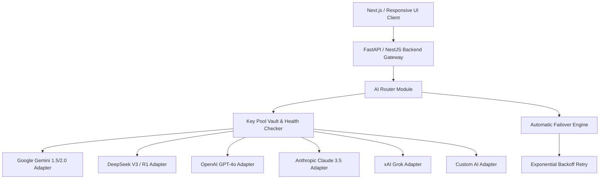

# AI IELTS — Complete World-Class Master System Architecture & Phased Implementation Plan

## Executive Summary
This document specifies the end-to-end production architecture, responsive UX design strategy, database entity-relationship schema, API contract, multi-provider AI routing mechanism, diagnostic testing engine, security compliance, and 27-phase implementation roadmap for the **AI IELTS Learning, Practice, Evaluation & Computer-Based Testing (CBT) Ecosystem**.

The product caters to both **IELTS Academic** and **IELTS General Training** candidates across all 4 skills (**Listening, Reading, Writing, Speaking**), offering a native experience across Desktop, Laptop, Tablet, Android, and iOS devices.

---

## 1. System Vision & Core Cycle Architecture

### 1.1 The Core Learning Loop
```
ASSESS (Diagnostic Test / Objective Scoring)
  ↓
ANALYZE (Weakness Engine & Skill Graph)
  ↓
TEACH (Multilingual AI Teacher & 5-Level Scaffolding)
  ↓
GUIDED PRACTICE (AI Hints & Strategy)
  ↓
INDEPENDENT PRACTICE (Self-Paced Skill Exercises)
  ↓
EVALUATE (Deterministic Objective / Rubric-based Subjective AI)
  ↓
IDENTIFY WEAKNESS (Automated Mistake Notebook & Skill Graphs)
  ↓
ADAPT (Personalized Dynamic Daily Study Plan)
  ↓
REASSESS (Section Test & CBT Mock Exam)
```

---

## 2. User Roles & Role-Based Access Control (RBAC)

| Role | Access Permissions & Capabilities |
| :--- | :--- |
| **Student** | Diagnostic Test, Daily Study Plan, AI Teacher Chat, Practice Engine (Reading, Listening, Writing, Speaking), Audio Recorder, Mistake Notebook, Progress Analytics, CBT Mock Exam, Profile Settings. |
| **Admin** | User Management, Content & Question Bank CRUD, AI Provider Vault, API Key Pool Monitor, AI Health & Latency Metrics, Prompt Versioning, Subscription Mapping, Security Audit Logs. |

---

## 3. Diagnostic Test & Onboarding Engine

1. **8-Step Onboarding**:
   - Step 1: Full Name
   - Step 2: IELTS Type (*Academic* vs. *General Training*)
   - Step 3: Target Band (5.0 to 9.0)
   - Step 4: Current Estimated Level
   - Step 5: Target Exam Date
   - Step 6: Daily Available Study Time (30m, 1h, 2h, 3h+)
   - Step 7: Mother Language (Bengali, Hindi, Arabic, Spanish, etc.)
   - Step 8: AI Teacher Language Mode (*English Only*, *Mother Language Only*, *English + Mother Language*)

2. **Diagnostic Test Suite**:
   - Shortened 15-minute diagnostic test evaluating all 4 skills.
   - Outputs: *Estimated Reading Band*, *Estimated Listening Band*, *Estimated Writing Band (AI)*, *Estimated Speaking Band (AI)*, *Overall Estimated Band*, *Primary Weakness Tag*.
   - **Rule**: AI estimates are clearly labeled as *"AI Estimated Band"* (never claimed as official IELTS results).

---

## 4. AI Teacher System Architecture & 5 Help Levels

The **AI Teacher** maintains state context across: Student Target Band, Mother Language, Teacher Language Preference, Active Question ID, Question Type, Student Draft, and Mistake History.

```
Help Request Triggered
  ↓
Level 1: HINT (Subtle direction without answer)
  ↓
Level 2: STRATEGY (IELTS technique explanation)
  ↓
Level 3: CONCEPT EXPLANATION (Grammatical / Lexical breakdown)
  ↓
Level 4: DETAILED REASONING (Step-by-step logic)
  ↓
Level 5: FULL EXPLANATION & PARAPHRASE (Complete evidence walkthrough)
```

---

## 5. Multi-Provider AI Router & Key Pool Vault



### Key Vault Features
* **Multi-Key Pool**: Allows 5+ API keys per provider.
* **Status Flags**: `Active`, `Testing`, `Rate Limited (429)`, `Authentication Error`, `Quota Exhausted`, `Disabled`.
* **Health Daemon**: Continuous ping and latency tracking (ms), auto-cooling rate-limited keys.

---

## 6. Database ERD & Entity Architecture

```mermaid
erDiagram
    USERS ||--o{ PROFILES : owns
    USERS ||--o{ PRACTICE_RESULTS : records
    USERS ||--o{ WRITING_SUBMISSIONS : submits
    USERS ||--o{ SPEAKING_SESSIONS : records
    USERS ||--o{ MOCK_ATTEMPTS : attempts
    USERS ||--o{ MISTAKE_NOTEBOOK : logs

    QUESTIONS ||--o{ QUESTION_OPTIONS : has
    QUESTIONS ||--o{ ANSWER_KEYS : defines

    WRITING_SUBMISSIONS ||--o1 WRITING_EVALUATIONS : evaluated_by
    SPEAKING_SESSIONS ||--o1 SPEAKING_EVALUATIONS : evaluated_by

    AI_PROVIDERS ||--o{ AI_CREDENTIALS : vault
    AI_PROVIDERS ||--o{ AI_REQUEST_LOGS : tracks
```

---

## 7. Phased Implementation Roadmap (27 Phases)

- **Phase 1**: System Architecture & Specification Alignment
- **Phase 2**: PostgreSQL / SQLite Database Schema & Models
- **Phase 3**: Authentication & RBAC System
- **Phase 4**: Design System & Fluid CSS Token Architecture
- **Phase 5**: Responsive UI Foundation & Navigation Shell
- **Phase 6**: Question Bank Schema & CRUD Engine
- **Phase 7**: Reading Engine (Academic & GT, Split CBT View)
- **Phase 8**: Listening Engine (HLS Audio Player & Word Limit Validation)
- **Phase 9**: Writing Engine (Distraction-Free Editor & Word Counter)
- **Phase 10**: Speaking Engine (WebAudio Recorder & Transcription Pipeline)
- **Phase 11**: AI Provider Adapters (Gemini, DeepSeek, OpenAI, Claude, Grok, Custom)
- **Phase 12**: Multi-Key Vault AI Router & Fallback Chain
- **Phase 13**: Multilingual AI Teacher & 5-Level Help Engine
- **Phase 14**: Rubric-Based Writing AI Evaluation Engine
- **Phase 15**: Rubric-Based Speaking AI Evaluation Engine
- **Phase 16**: Adaptive Learning Engine & Weakness Detection
- **Phase 17**: Automated Mistake Notebook Engine
- **Phase 18**: Dynamic Personalized Study Plan Generator
- **Phase 19**: Full Computer-Based Mock Exam Simulator
- **Phase 20**: Responsive Admin Panel & Key Health Dashboard
- **Phase 21**: Progress Analytics & Accuracy Breakdown
- **Phase 22**: AI Provider Quality & Cost Benchmarking Suite
- **Phase 23**: Subscription Tier Mapping & Gateways
- **Phase 24**: Security Hardening, Encryption & Rate Limiting
- **Phase 25**: Performance Optimization & Media Streaming
- **Phase 26**: Cross-Device QA & Accessibility Audit (WCAG 2.2 AA)
- **Phase 27**: Cloud Hosting BD Deployment & Production Launch

---

## Verification & Completion Standard

Every phase is validated against 4 criteria:
1. **Functional Integrity**: Backend APIs return correct data with persistence in DB.
2. **Responsive UX**: Verified on Desktop (1920x1080), Tablet (1024x768), and Mobile (390x844).
3. **Robust Safety**: Fallbacks execute gracefully without breaking student progress or auto-saves.
4. **Security & Privacy**: Zero API key leakage to client frontend.
